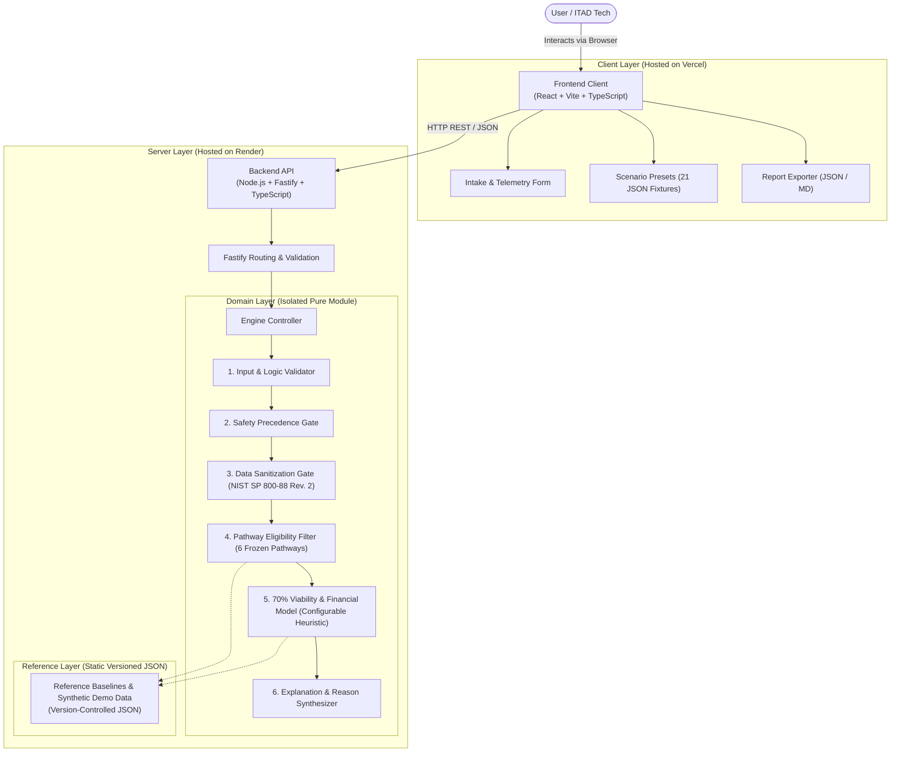

# SYSTEM ARCHITECTURE: E-CYCLEPILOT AI
**Full Title:** E-CyclePilot AI: E-Waste Recovery & Circularity Decision Engine  
**Document Code:** ARC-ECP-001  
**Version:** 2.0.0 (Specification Lock)  
**Status:** Approved System Architecture  

---

## 1. Architectural Principles & System Goals

The architecture of **E-CyclePilot AI** is guided by five foundational principles:

1. **Safety First, Economics Second:** The decision pipeline evaluates safety gates prior to any commercial, salvage, or refurbishing calculations. Hazardous devices must never be approved for ordinary reuse or repair merely because estimated resale value is high.
2. **Strict Determinism:** Pure functional logic guarantees that given the exact same input, the engine yields the exact same pathway and reason codes with 100% bitwise reproducibility.
3. **Decoupled Engine Core:** The decision engine is isolated from transport layers (HTTP, UI) as a pure TypeScript module (`@engine/core`), allowing execution in the browser, in Node.js, in CLI scripts, or behind Fastify.
4. **Zero-API Dependency Baseline:** Operates without paid LLMs or external cloud AI services, ensuring high reliability, sub-20ms latency, zero API token cost, and no hallucination risk.
5. **Stateless Simplicity:** No persistent database (Supabase/PostgreSQL) is included in the initial architecture to minimize operational failure points during the hackathon lifecycle.

---

## 2. High-Level System Architecture



---

## 3. Component & Boundary Specifications

### 3.1 Frontend Web Client
- **Technology:** React 18+, Vite, TypeScript.
- **Styling:** Modular Vanilla CSS with modern custom property design tokens (dark/light theme, accessible contrast, high-visibility hazard cues).
- **Responsibilities:**
  - Ingest user telemetry across device specs, physical condition, functional state, battery behavior, and financial metrics.
  - Provide a one-click **Preset Scenarios Toolbar** loaded with all 21 test scenarios defined in `ACCEPTANCE_TEST_PLAN.md`.
  - Render an interactive **Decision Visualizer** showing:
    - Primary recommended circularity pathway.
    - High-visibility hazard banner when `SPECIAL_HANDLING` is tripped.
    - Data sanitization blocker checklist and NIST SP 800-88 Rev. 2 guidance notes.
    - Pathway comparison cards showing disqualified alternatives and disqualification reasons.
    - Financial margin breakdown or explicit `DATA_UNAVAILABLE` badges.
  - Client-side export of comprehensive assessment reports in formatted Markdown and raw JSON.

### 3.2 Backend API Service
- **Technology:** Node.js (v20 LTS), Fastify, TypeScript.
- **Responsibilities:**
  - Host stateless HTTP REST endpoints with strict JSON schema validation.
  - Implement Cross-Origin Resource Sharing (CORS) configured for the Vercel frontend.
  - Handle rate limiting and payload size restrictions ($\le 64\text{KB}$ per request).
  - Provide health checks and telemetry diagnostics.

### 3.3 Isolated Decision Engine Core (`@engine/core`)
- **Technology:** Pure TypeScript with zero runtime dependencies.
- **Location:** Dedicated source directory `/packages/engine` (or `/src/engine`).
- **Characteristics:**
  - 100% side-effect-free pure functions.
  - No `Math.random()`, no unseeded clock calls, no file system I/O, no network calls.
  - Completely decoupled from Fastify and React; directly unit-testable via Vitest.

### 3.4 Static Reference Data & Scenario Fixtures
- **Technology:** Version-controlled static `.json` files.
- **Responsibilities:**
  - Store baseline material scrap rates, standard modular components, and default economic thresholds.
  - Store the 21 standardized test scenarios matching `ACCEPTANCE_TEST_PLAN.md`.
  - Every file containing demo financial numbers is explicitly tagged with `_meta.dataType = "SYNTHETIC_DEMO_DATA"`.

---

## 4. Decision Pipeline & Rule Execution Flow

The engine processes input objects through a sequential six-stage evaluation pipeline:

```
[DeviceAssessmentRequest]
           │
           ▼
[Stage 1: Validation & Logical Consistency Check]
           │ (Valid payload)
           ▼
[Stage 2: Safety Precedence Gate]
           ├────────────────────────────┐
           ▼ (Hazard detected)          ▼ (Safe)
     [SPECIAL_HANDLING]     [Stage 3: Data Sanitization Gate]
     (Resale / Repair blocked)          │
                                        ▼
                            [Stage 4: Pathway Eligibility & Ranking]
                                        │
                                        ▼
                            [Stage 5: Conditional Economic Appraisal]
                                        │
                                        ▼
                            [Stage 6: Synthesis & Reason Codes]
                                        │
                                        ▼
                            [DeviceAssessmentResponse]
```

### Stage Details:
1. **Stage 1 (Validation):** Rejects invalid device categories, negative values, and logical contradictions (e.g., `powerState: "NO_POWER"` combined with `bootState: "OS_BOOTS"`).
2. **Stage 2 (Safety Precedence Gate):**
   - Evaluates battery swelling (`CONFIRMED_BULGING`, `SUSPECTED`), thermal burns (`BURNT`, `SCORCHED`), and chemical leaks (`BROKEN_MERCURY_LAMP`, `LEAKING_BATTERY_ELECTROLYTE`).
   - **Precedence Rule:** If any hazard is found:
     - Primary pathway is forcibly locked to `SPECIAL_HANDLING`.
     - Resale, repair, refurbishment, and standard recycling pathways are disqualified.
     - Hazmat containment and dangerous transport restriction flags (UN 3480/3481) are issued.
     - **Safety Invariant:** Safety unconditionally overrides age obsolescence (TC-SAF-006). A 10-year-old device with a swollen battery routes to `SPECIAL_HANDLING`, not standard recycling.
     - Pipeline skips directly to Stage 6.
3. **Stage 3 (Data Sanitization Gate):**
   - Ingests non-volatile media presence. If storage is un-wiped (`UNENCRYPTED_DATA_PRESENT`), sets blocking flag `complianceFlags.dataSanitizationRequired = true` citing NIST SP 800-88 Rev. 2 guidance.
   - *Clear Boundary:* The application assesses whether sanitization is required. It does not perform disk wiping, validate a sanitization operation, or issue a sanitization certificate.
4. **Stage 4 (Pathway Eligibility & Ranking):**
   - `REUSE`: Age $\le 4.0$ years, functional power & OS boot, pristine/minor chassis, battery $\ge 80\%$.
   - `REPAIR`: Isolated single defect (screen/battery/keyboard), powers on, repair cost $\le 70.0\%$ of resale value (or repair quote unconfirmed).
   - `REFURBISHMENT`: Functional board, cosmetic scuffs, degraded battery ($<80\%$), missing OS or minor faults.
   - `COMPONENT_RECOVERY`: Mainboard unrecoverable or repair uneconomic, but modular components (RAM, SSD, GPU, display panel) are verified functional.
   - `FORMAL_RECYCLING`: Age $\ge 10.0$ years (obsolescence), unrepairable with zero modular harvestable parts, or unclassifiable safe fallback.
5. **Stage 5 (70% Viability Configurable Heuristic & Financial Model):**
   - The 70% repair-cost-to-market-value threshold is a configurable project heuristic (not a universal standard).
   - Computes Cost Ratio:
     $$\text{Cost Ratio} = \frac{\text{estimatedRepairCost}}{\text{estimatedMarketValue}}$$
   - **Boundary Rule:** Ratio $\le 0.70$ ($70.0\%$) is **eligible**. Ratio $> 0.70$ is **prohibitive**, downgrading device to `COMPONENT_RECOVERY` (if parts exist) or `FORMAL_RECYCLING`.
   - **Closed Decision A (Damaged screen, missing repair quote):** Device remains a `REPAIR` candidate, but reason codes include `RULE_REP_003_ECONOMIC_FEASIBILITY_UNCONFIRMED`, and `financialSummary.status = "DATA_UNAVAILABLE"`.
   - **Closed Decision C (Modular parts, missing prices):** Verified working parts populate `harvestManifest`, but `financialSummary.salvageYieldTotal = null` and `status = "DATA_UNAVAILABLE"`.
   - **Missing Data Rule:** If required financial inputs are omitted, status is set to `DATA_UNAVAILABLE`, numeric outputs are set to `null`, and zero hallucinated numbers are returned.
6. **Stage 6 (Synthesis):** Compiles primary pathway, eligible alternatives, disqualified alternatives with explicit disqualification reasons, triggered machine-readable Reason Codes, action checklist, and uncertainty warnings.

---

## 5. API Contracts & Data Specifications

### 5.1 Endpoint Definitions

| Method | Endpoint | Description | Request Body | Response Body |
| :--- | :--- | :--- | :--- | :--- |
| `GET` | `/health` | Service health & liveness probe | None | `{ status: "ok", timestamp: string, version: string }` |
| `GET` | `/api/v1/scenarios` | Retrieve built-in test scenarios (21 fixtures) | None | `{ scenarios: ScenarioFixture[] }` |
| `POST` | `/api/v1/assess` | Triage and evaluate device payload | `DeviceAssessmentRequest` | `DeviceAssessmentResponse` |

---

### 5.2 TypeScript Data Interfaces

```typescript
// ==========================================
// REQUEST PAYLOAD CONTRACT
// ==========================================

export type DeviceCategory = 'LAPTOP' | 'SMARTPHONE' | 'DESKTOP' | 'TABLET';

export type PowerState = 'POWERS_ON' | 'INTERMITTENT' | 'NO_POWER';
export type BootState = 'OS_BOOTS' | 'POST_PASS' | 'BOOT_LOOP' | 'DEAD';
export type DisplayState = 'WORKING' | 'CRACKED_FUNCTIONAL' | 'CRACKED_NO_DISPLAY' | 'ARTIFACTS' | 'NOT_APPLICABLE' | 'UNKNOWN';

export type BatterySwellingState = 'NONE' | 'SUSPECTED' | 'CONFIRMED_BULGING';
export type ThermalBehavior = 'NORMAL' | 'OVERHEATING';

export type StorageMediaType = 'NVME_SSD' | 'SATA_SSD' | 'HDD' | 'EMMC_SOLDERED' | 'REMOVABLE_CARD' | 'NO_STORAGE';
export type SanitizationState = 'VERIFIED_WIPED' | 'ENCRYPTED_LOCKED' | 'UNENCRYPTED_DATA_PRESENT' | 'DAMAGED_PHYSICALLY';

export type ThermalDamage = 'NONE' | 'BURNT' | 'SCORCHED';
export type ChemicalHazard = 'NONE' | 'LEAKING_BATTERY_ELECTROLYTE' | 'BROKEN_MERCURY_LAMP';
export type ChassisIntegrity = 'INTACT' | 'SCRATCHED' | 'WARPED' | 'CRACKED' | 'DAMAGED';

export interface ModularComponentItem {
  name: string;
  functional: boolean;
  salvageValue?: number | null;
}

export interface DeviceAssessmentRequest {
  device: {
    category: DeviceCategory;
    brand: string;
    model?: string;
    ageYears: number;
  };
  physicalCondition: {
    chassisIntegrity: ChassisIntegrity;
    screenCondition: string;
    liquidDamage: boolean;
    thermalDamage: ThermalDamage;
    chemicalHazard: ChemicalHazard;
  };
  functionalStatus: {
    powerState: PowerState;
    bootState: BootState;
    displayState: DisplayState;
  };
  battery?: {
    present: boolean;
    healthPercentage?: number | null;
    swellingState: BatterySwellingState;
    thermalBehavior: ThermalBehavior;
  };
  storage?: {
    mediaType: StorageMediaType;
    sanitizationState: SanitizationState;
  };
  modularComponents?: ModularComponentItem[];
  economics?: {
    estimatedMarketValue?: number | null;
    estimatedRepairCost?: number | null;
    estimatedComponentSalvageValue?: number | null;
    scrapWeightKg?: number | null;
  };
}

// ==========================================
// RESPONSE PAYLOAD CONTRACT
// ==========================================

export type CircularityPathway = 
  | 'SPECIAL_HANDLING'
  | 'REUSE'
  | 'REPAIR'
  | 'REFURBISHMENT'
  | 'COMPONENT_RECOVERY'
  | 'FORMAL_RECYCLING';

export interface PathwayComparisonItem {
  pathway: CircularityPathway;
  status: 'RECOMMENDED' | 'ELIGIBLE' | 'DISQUALIFIED';
  score: number;
  rationale: string;
  disqualificationReason?: string;
}

export interface FinancialSummary {
  status: 'CALCULATED' | 'DATA_UNAVAILABLE';
  currency: string;
  estimatedMarketValue: number | null;
  estimatedRepairCost: number | null;
  costRatioPercent: number | null;
  netRepairMargin: number | null;
  salvageYieldTotal: number | null;
  notes: string;
}

export interface SafetyAlert {
  active: boolean;
  hazardLevel: 'NONE' | 'WARNING' | 'CRITICAL';
  hazardsIdentified: string[];
  mandatoryContainmentInstructions: string[];
}

export interface DeviceAssessmentResponse {
  assessmentId: string;
  timestamp: string;
  primaryPathway: CircularityPathway;
  primaryRationale: string;
  safetyAlert: SafetyAlert;
  complianceFlags: {
    dataSanitizationRequired: boolean;
    hazardousTransportRestricted: boolean;
  };
  eligiblePathways: CircularityPathway[];
  disqualifiedPathways: CircularityPathway[];
  pathwayComparison: PathwayComparisonItem[];
  reasonCodes: string[];
  actionChecklist: string[];
  harvestManifest?: ModularComponentItem[];
  financialSummary: FinancialSummary;
  uncertaintyWarnings: string[];
}
```

---

## 6. Security, Data Privacy & Trust Model

1. **Zero Secret Footprint:**
   - No external API keys (OpenAI, Gemini, Anthropic) or database tokens are baked into client bundles or required on the backend.
2. **Stateless Processing:**
   - Assessments are evaluated purely in memory. No customer data or hardware serial numbers are written to persistent storage.
3. **Data Sanitization Gate (NIST SP 800-88 Rev. 2):**
   - If storage media has unencrypted data, the engine sets `complianceFlags.dataSanitizationRequired = true` citing NIST SP 800-88 Rev. 2 guidance.
   - *Clear Boundary:* The application assesses whether sanitization is required. It does not perform disk wiping, validate a sanitization operation, or issue a sanitization certificate.
4. **Input Defense:**
   - Fastify enforces strict payload size limits (64KB), rejects unknown JSON properties, and protects against prototype pollution.

---

## 7. Testing Topology & Verification Strategy

The system uses **Vitest** across three distinct testing tiers:

```
          / \
         /   \     Tier 3: End-to-End API Integration Tests (Fastify routes)
        /     \    Tests HTTP contracts, headers, CORS, status codes.
       /───────\
      /         \   Tier 2: Scenario Acceptance Suite (21 Scenarios)
     /           \  Directly tests ATP-ECP-001 acceptance criteria.
    /─────────────\
   /               \ Tier 1: Engine Unit Tests (Rules, Math, Gates)
  /─────────────────\ Tests safety predicates, economic formulas in isolation.
```

- **Execution Command:** `npm test` runs all three tiers.
- **Continuous Integration:** Automated on every pull request via GitHub Actions.

---

## 8. Deployment Topology & Environments

### 8.1 Hosting Platforms
- **Frontend Client:** Deployed to **Vercel** as a static single-page application (SPA).
- **Backend API Service:** Deployed to **Render** as a Node.js web service running in containerized mode.

### 8.2 Environment Configuration
- Frontend:
  - `VITE_API_URL`: Points to Render backend URL (e.g., `https://e-cyclepilot-api.onrender.com`).
- Backend:
  - `PORT`: Set dynamically by Render (defaults to 3001 locally).
  - `CORS_ORIGIN`: Configured to permit requests from the Vercel production domain and `localhost:5173`.
